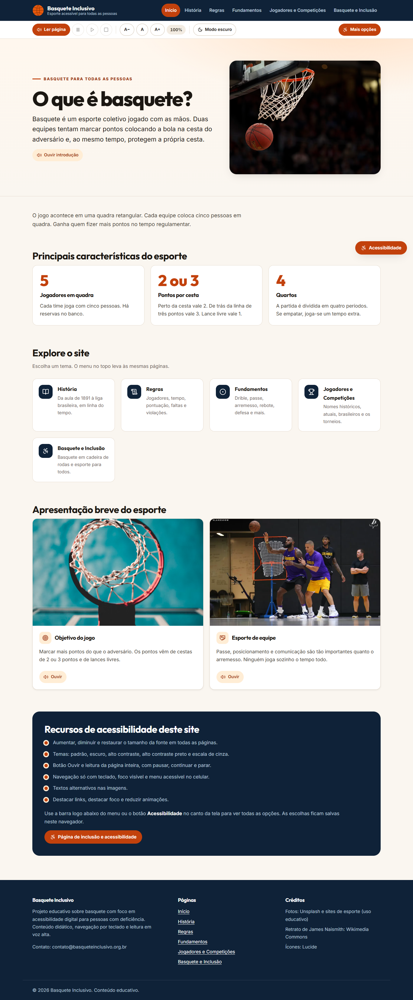

# Basquete Inclusivo

Site educativo sobre basquete com foco em **acessibilidade digital**: leitura em voz alta, controle do tamanho da fonte, cinco temas de cor (incluindo alto contraste), navegação completa pelo teclado e textos alternativos nas imagens.

Demo: https://basqueteinclusivo.vercel.app



## Páginas

- **Início**: o que é o basquete, números do jogo e atalhos para os temas
- **História**: origem, expansão e linha do tempo
- **Regras**: a quadra e as regras principais
- **Fundamentos**: drible, passe, arremesso, rebote, defesa, bandeja, enterrada e movimentação
- **Jogadores e Competições**: atletas históricos, atuais e brasileiros, e os principais torneios
- **Basquete e Inclusão**: basquete em cadeira de rodas e adaptações

## Acessibilidade

| Recurso | Onde |
| --- | --- |
| Ler a página inteira (pausar, continuar, parar) e botão **Ouvir** em cada bloco | Barra do topo, painel e cards |
| Fonte de 87,5% a 175% | Barra do topo e painel |
| Temas: padrão, escuro, alto contraste, alto contraste preto, escala de cinza | Painel (modo escuro também na barra) |
| Destacar links, destacar foco, reduzir animações | Painel |
| Pular para o conteúdo, foco visível, menu que fecha com Esc | Todas as páginas |
| Preferências salvas no navegador (`localStorage`) | Automático |

Nenhum áudio toca sozinho. A redução de animações também segue a preferência do sistema operacional.

## Como rodar

```bash
npm install
npm run dev     # http://localhost:5173
npm run build   # gera a pasta dist/
npm run lint
```

## Estrutura

```
src/
├── App.jsx                       rotas
├── context/
│   └── AccessibilityContext.jsx  preferências, fonte, tema e leitura em voz alta
├── data/                         todo o conteúdo do site, separado por assunto
│   ├── navigation.js             páginas do menu
│   ├── media.js                  imagens (src + alt)
│   ├── timeline.js  rules.js  fundamentals.js  players.js
│   └── themes.js                 lista de temas
├── components/
│   ├── layout/                   Layout, Header, A11yBar, Page, Footer, WelcomeBanner
│   ├── a11y/                     painel, leitura em voz alta, fonte e temas
│   └── ui/                       Button, Icon, Figure, Section, cards e linha do tempo
├── pages/                        uma página por rota
└── styles/
    ├── tokens.css                cores de cada tema
    ├── base.css                  reset, tipografia e utilitários
    ├── layout.css                cabeçalho, barra, páginas e rodapé
    └── components.css            botões, cards, linha do tempo e painel
```

Para mudar um texto ou imagem, edite o arquivo em `src/data/`. Para mudar as cores de um tema, edite `src/styles/tokens.css`.

## Tecnologias

React 19, React Router 7, Vite e ícones [Lucide](https://lucide.dev).
